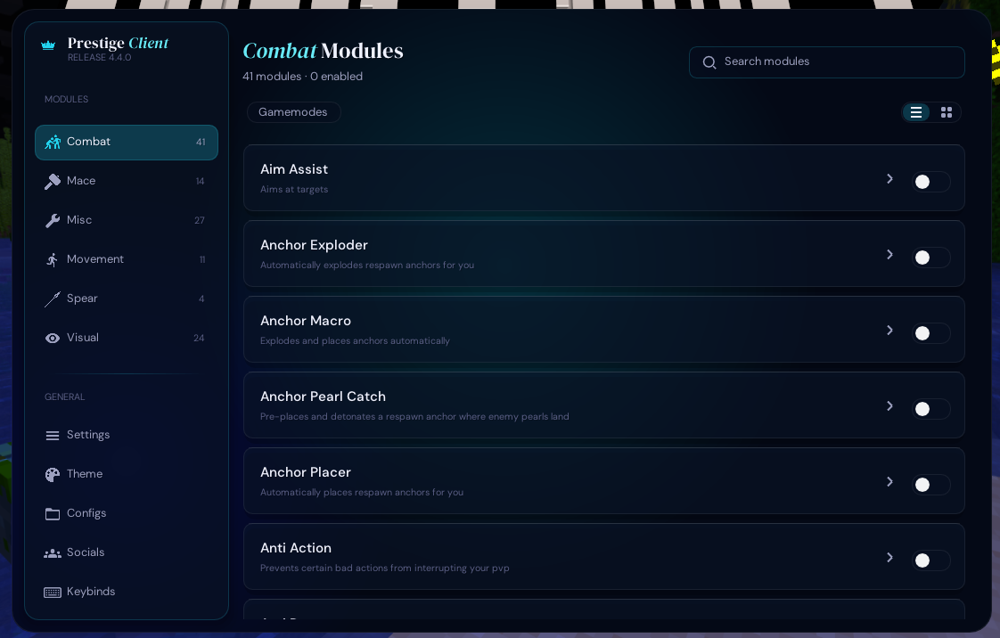

# Open Prestige

A fully deobfuscated, IntelliJ-ready, runnable open sourced version of the Prestige client for Fabric 1.21.11.

<p align="center">
  
  
</p>

<p align="center">
  
</p>

Cracked by Skid Solutions.
Join the Discord: https://discord.gg/skidsolutions

## Why?
zPrestige couldnt give a fuck it seems about his client. AI slop all over, no time nor thought it seems goes into testing if things actually work. banned in 2 games with the most popular CAS config on mcpvp with countless modules flagging grim on actest.
vikas please also, improve your prot. i shouldnt be able to get all the files for your shitty client running a **single** 200 line python file. :sob: 

## Run

```
run.bat
```

`run.bat` starts the dev client (offline) and writes everything to `logs\run_<time>.log`
(plus a copy of `latest.log` and any crash report). Open the ClickGUI with the menu key (default `RIGHT SHIFT`).

Open in IntelliJ: File > Open > this folder (`build.gradle`), "Open as Project", Gradle JVM = JDK 21,
then use the generated **Minecraft Client** run configuration.

Build a self-contained mod jar (imgui-java + natives and ClassTransform are bundled):

```
gradlew build
```

## Credits

- **technix**: sourcing / Frida scripts
- **stutheguyy**: fixing
- **bynbang / nitrogenoliquido**: ZKM transformers
- **dario**: AI models
